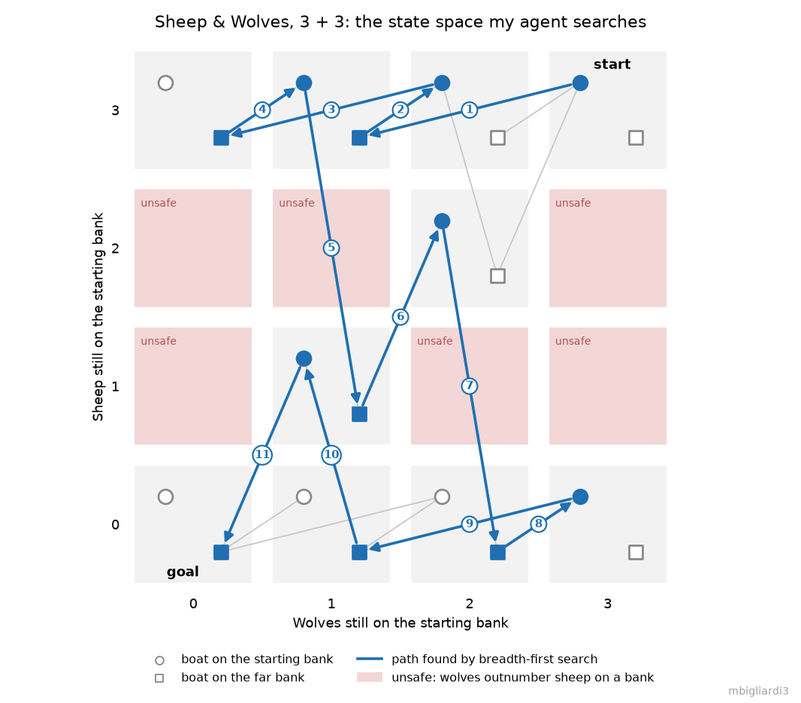
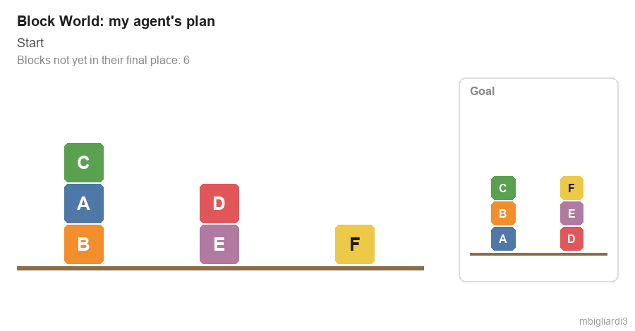
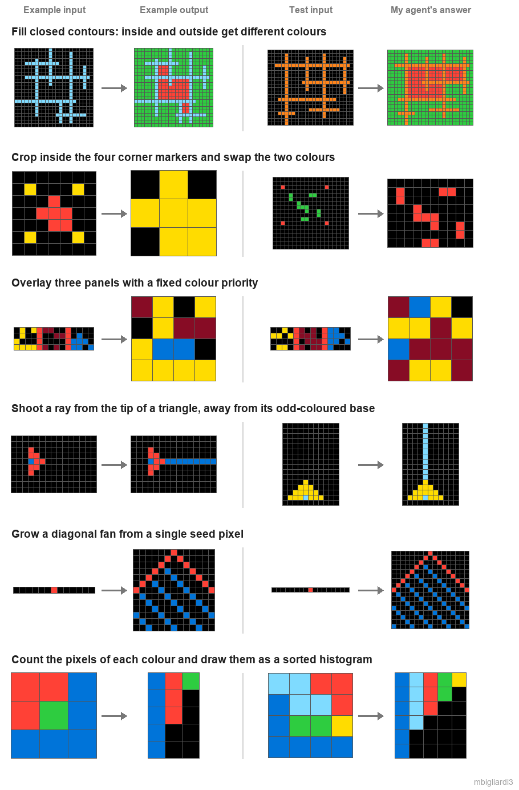
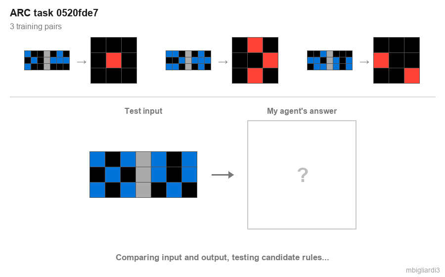

# CS 7637 — Knowledge-Based Artificial Intelligence

**Georgia Institute of Technology · Online Master of Science in Computer Science (OMSCS) · Summer 2025**

**Final grade: A**

This repository is a write-up of what I studied and built in *CS 7637 Knowledge-Based Artificial Intelligence:
Cognitive Systems* (also known as *KBAI*). It covers the topics of the course, how each project relates to them,
and figures and animations from my own local runs.

> **Why there is no source code here:** the course policies do not allow students to post the work they submit
> publicly, during or after the semester, because many assignments are reused. Students may still talk about
> and write about what they did. Because of that, this repository contains only **descriptions written by me**
> and **media from my local runs** (watermarked with my GT username). It contains no solution code, starter code,
> reports, assignment specifications or lecture material. If you are a recruiter or an interviewer and would like
> to discuss the implementations, I am happy to walk through them in person.

---

## Table of contents

- [About the course](#about-the-course)
- [Topics at a glance](#topics-at-a-glance)
- [How the pieces connect](#how-the-pieces-connect)
- [Mini-projects](#mini-projects)
  - [1. Sheep & Wolves — semantic networks and state-space search](#1-sheep--wolves--semantic-networks-and-state-space-search)
  - [2. Block World — means-ends analysis and planning](#2-block-world--means-ends-analysis-and-planning)
  - [3. Sentence Reading — understanding with frames and rules](#3-sentence-reading--understanding-with-frames-and-rules)
  - [4. Monster Classification — learning a concept from examples](#4-monster-classification--learning-a-concept-from-examples)
  - [5. Monster Diagnosis — abductive diagnosis as a search for the smallest explanation](#5-monster-diagnosis--abductive-diagnosis-as-a-search-for-the-smallest-explanation)
- [Semester project: an agent for the ARC-AGI benchmark](#semester-project-an-agent-for-the-arc-agi-benchmark)
- [Homework, exams and participation](#homework-exams-and-participation)
- [Skills and tools](#skills-and-tools)
- [Takeaways](#takeaways)
- [Public resources](#public-resources)

---

## About the course

KBAI looks at artificial intelligence through the lens of **cognitive systems**: agents that reason with explicit
knowledge, and that are designed by asking how a human would approach the same problem. Instead of learning
everything from large amounts of data, a knowledge-based agent represents what it knows (as semantic networks,
frames, production rules, cases or logic), reasons over that representation and learns from a few examples,
often one at a time. Each lesson introduces a representation or a reasoning method and connects it to what is
known about human cognition.

The course has a strong "learning by doing" component. Five mini-projects each ask for an agent that solves a
small, well-defined problem with a method from the lectures, and a semester-long project asks for an agent
for the **Abstraction and Reasoning Corpus (ARC-AGI)**, a benchmark of visual puzzles designed to be easy for
people and hard for machines. The code always comes with written reports that explain how the agent works,
how it performs, how efficient it is, and how its reasoning compares with a human's.

| | |
|---|---|
| **Institution** | Georgia Institute of Technology, College of Computing |
| **Program** | OMSCS (Online Master of Science in Computer Science) |
| **Semester** | Summer 2025 |
| **Lectures** | Video lessons by Ashok Goel and David Joyner |
| **Assessment** | Five mini-projects (agent + report), the ARC-AGI project (milestones, final agent, reports), written homework, exams, class participation |
| **Language** | Python (my agents use only the standard library and NumPy) |
| **Official page** | [omscs.gatech.edu/cs-7637-knowledge-based-ai](https://omscs.gatech.edu/cs-7637-knowledge-based-ai) |

---

## Topics at a glance

| # | Unit | Key ideas |
|---|------|-----------|
| 1 | **Fundamentals** | What makes an agent knowledge-based, the cognitive-systems view, deliberation, reaction and metacognition |
| 2 | **Semantic networks** | Knowledge representations as lexicon, structure and semantics, representing a problem as states and transformations |
| 3 | **Generate & test** | Generating candidate solutions and testing them, and how smart generators and testers keep the search small |
| 4 | **Means-ends analysis and problem reduction** | Choosing the operator that most reduces the distance to the goal, splitting a hard goal into sub-goals |
| 5 | **Production systems** | Rules as condition–action pairs, working memory, impasses, chunking (the SOAR architecture) |
| 6 | **Frames** | Slots and fillers, default values, frames for understanding stories |
| 7 | **Learning by recording cases and case-based reasoning** | Storing and retrieving cases, nearest-neighbour retrieval, adapting, evaluating and storing a solution |
| 8 | **Incremental concept learning and classification** | Generalizing and specializing a concept from one example at a time, heuristics for learning, concepts as classes |
| 9 | **Logic and planning** | Formal logic and inference, planning as search over states, goal conflicts, partial-order planning |
| 10 | **Understanding, commonsense reasoning and scripts** | Thematic role frames, primitive actions, scripts as stereotyped event sequences |
| 11 | **Explanation-based learning and analogical reasoning** | Learning by explaining an example, retrieving, mapping and transferring knowledge across domains |
| 12 | **Version spaces** | Converging on a concept by moving a specific and a general model towards each other |
| 13 | **Constraint propagation, configuration and diagnosis** | Satisfying constraints between variables, configuring a design from components, diagnosis as abduction |
| 14 | **Learning by correcting mistakes and meta-reasoning** | Explaining and fixing a failure, reasoning about one's own reasoning and learning |
| 15 | **Advanced topics and cognitive systems** | Visuospatial reasoning, systems thinking, design and creativity, and how the course's methods fit into one cognitive architecture |

---

## How the pieces connect

Each project is built on one or more lecture units. The mini-projects isolate one method each; the ARC-AGI
project needs several of them at once.

| Project | Semantic networks & search | Generate & test | Means-ends & planning | Production rules & frames | Concept learning & classification | Diagnosis | Analogy & visual reasoning |
|---|:-:|:-:|:-:|:-:|:-:|:-:|:-:|
| [Sheep & Wolves](#1-sheep--wolves--semantic-networks-and-state-space-search) | ● | ● | | | | | |
| [Block World](#2-block-world--means-ends-analysis-and-planning) | ○ | ○ | ● | | | | |
| [Sentence Reading](#3-sentence-reading--understanding-with-frames-and-rules) | | | | ● | | | |
| [Monster Classification](#4-monster-classification--learning-a-concept-from-examples) | | | | | ● | | |
| [Monster Diagnosis](#5-monster-diagnosis--abductive-diagnosis-as-a-search-for-the-smallest-explanation) | ○ | ● | | | | ● | |
| [ARC-AGI agent](#semester-project-an-agent-for-the-arc-agi-benchmark) | | ● | | ● | ● | | ● |

● = main topic of the project · ○ = also used

```text
 represent & search        reduce the distance        read with rules         learn from examples        find the explanation
┌────────────────────┐   ┌────────────────────┐   ┌────────────────────┐   ┌────────────────────┐   ┌────────────────────┐
│ Sheep & Wolves:    │ → │ Block World:       │ → │ Sentence Reading:  │ → │ Monster            │ → │ Monster Diagnosis: │
│ states + BFS       │   │ heuristic, greedy  │   │ lexicon, frames,   │   │ Classification:    │   │ smallest set of    │
│                    │   │ moves              │   │ production rules   │   │ feature evidence   │   │ diseases (B&B)     │
└────────────────────┘   └────────────────────┘   └────────────────────┘   └────────────────────┘   └────────────────────┘
                                                            │
                                                            ▼
                              ARC-AGI agent: describe how each example changes, generate candidate
                              rules, test them on every example, apply the one that fits to the test grid
```

---

## Mini-projects

Each mini-project gave a fixed interface (a class with a `solve` method), a handful of local examples and a
hidden test set on an autograder. Along with the code, each one required a short report answering the same
questions: how the agent works, how well it performs and where it fails, how efficient it is, and whether it
reasons the way a human would.

The figures and animations below come from **my own local runs** of my agents, on examples I chose. None of them is
taken from my reports.

### 1. Sheep & Wolves — semantic networks and state-space search

> **Topics:** semantic networks · state representation · generate & test · breadth-first search

**Problem.** A variant of the classic river-crossing puzzle. A number of sheep and wolves must cross a river with a boat
that holds one or two animals and cannot cross empty. If the wolves ever outnumber the sheep on either bank (when there is
at least one sheep there), the sheep are eaten. The agent must return the **shortest** sequence of crossings, or report
that no solution exists.

**What I implemented.**
- A compact representation in the spirit of a semantic network: a state is *(sheep on the starting bank, wolves on the
  starting bank, side of the boat)*, and the five possible boat loads are the transformations between states.
- A generator that applies every boat load to the current state, and a tester that rejects states that are
  impossible (negative counts) or unsafe (sheep outnumbered on a bank), together with states already visited.
- **Breadth-first search** over the states that survive the tester, which returns the shortest plan and stops as soon as the
  goal is generated. When the queue empties without reaching the goal, the agent reports that the puzzle has no solution.

**What I learned.** How much a good representation does for you: once the state is three numbers, the puzzle turns into a
small graph search, and pruning unsafe or repeated states at generation time keeps even larger instances fast.

<p align="center">
  <br>
  <sub>The state space for three sheep and three wolves. Each cell is a number of sheep and wolves still on the starting bank;
  a circle means the boat is on the starting bank, a square that it is on the far bank. Red cells are unsafe and are never generated.
  The blue arrows are the 11 crossings my agent returns.</sub>
</p>

---

### 2. Block World — means-ends analysis and planning

> **Topics:** means-ends analysis · heuristic search · planning · goal clobbering

**Problem.** Blocks labelled with letters are arranged in stacks on a table. The agent can move only the top block of a stack,
either onto another stack or onto the table, and must turn an initial arrangement into a goal arrangement **in as few moves as
possible**.

**What I implemented.**
- A **distance-to-goal heuristic**: the number of blocks that are not yet part of a correctly built stack prefix. A block counts as
  "in place" only if every block under it is also where the goal wants it, so moving a block onto a wrong base never looks like progress.
- **Means-ends move selection**: from each arrangement, the agent first looks for a move (onto another stack or onto the table) that
  reduces the distance and takes it immediately. Only when no move helps does it consider putting blocks on the table without
  increasing the distance, which is how it clears blocks that sit on top of the ones it needs.
- A breadth-first search over these filtered successors, with a visited set, so the agent can back out of a dead end instead of
  looping.

**What I learned.** Why pure means-ends analysis needs help: greedily reducing the difference works most of the time, but some
goals first require moves that do not look like progress (unstacking), so the operator selection has to allow them in a
controlled way.

<p align="center">
  <br>
  <sub>My agent's plan for an arrangement I made up. It first builds the stack that only needs blocks from the top of other piles,
  then unstacks the pile whose bottom block is wrong and rebuilds it. The counter is the heuristic the agent uses to choose moves.</sub>
</p>

---

### 3. Sentence Reading — understanding with frames and rules

> **Topics:** understanding · thematic role frames · production systems · knowledge engineering

**Problem.** The agent receives a short, simple sentence and a question about it, and must return the answer as a word or short
phrase: *who* did something, *what* they did or used, *where*, *when*, *what colour*, *how far*, *how many*. The sentences use
the most common English words and a set of first names.

**What I implemented.** A hand-built, knowledge-based reader with no statistical model:
- a **lexicon** that tags each known word with its part of speech, and a table of verb forms (regular and irregular) that maps every
  inflection to its base form, so "brought" in the sentence matches "bring" in the question;
- word categories that play the role of **frame slots**: people, names, places, times of day, colours, measurable adjectives, numbers;
- a set of **production rules** keyed on the question word and its context (for example *who … to/with*, *how + adjective*,
  *what … do*), each of which looks for the filler of the corresponding slot in the sentence: the agent before the verb, the object
  after it, a place, a time, a clock time, or the adjective in front of a noun.

A few answers from my agent on a sentence I wrote, *"Ada brought a big red box to the farm at 9:30am."*:

| Question | Answer |
|---|---|
| Who brought a box? | Ada |
| What did Ada bring? | box |
| What color is the box? | red |
| Where did Ada bring the box? | farm |
| When did Ada bring the box? | 9:30AM |
| How big is the box? | red ✗ |

The last line shows the typical failure: the *how + adjective* rule takes the adjective right before the noun, and here that is the
colour, not the size.

**What I learned.** How far a small, explicit knowledge base can go on constrained language, and how its weaknesses show up:
every rule is easy to explain, but each new sentence pattern tends to need a new rule, and rules start to interfere with each other.

---

### 4. Monster Classification — learning a concept from examples

> **Topics:** incremental concept learning · classification · generalization and specialization

**Problem.** The agent receives a small list of monsters, each described by a dozen categorical features (size, colour,
covering, foot type, number of legs, arms, eyes and horns, whether it lays eggs or has wings, gills or a tail) and labelled as belonging or not belonging to a species. It then has
to decide whether a new monster belongs to the same species.

**What I implemented.** A simple, explainable classifier in the spirit of concept learning. For every feature, the agent
records which values appear in positive examples and which appear in negative ones. A new monster gains a point for each
feature value seen among the positives and loses a point for each value seen among the negatives; it is classified as a member of the
species when the positive evidence is at least as strong as the negative.

**What I learned.** The link between the lectures' generalize/specialize view and a practical classifier, and the trade-off
between a model that can explain every decision and one that weighs features differently.

---

### 5. Monster Diagnosis — abductive diagnosis as a search for the smallest explanation

> **Topics:** diagnosis · abduction · set cover · branch and bound

**Problem.** Each disease raises, lowers or leaves unchanged the levels of 26 vitamins. When a patient has several diseases,
their effects combine (opposite effects cancel out). Given a list of diseases and a patient's vitamin levels, the agent
must return the **smallest set of diseases that explains all the symptoms**.

**What I implemented.**
- A **bitmask encoding** of each disease: one mask for the vitamins it raises and one for those it lowers, which makes combining
  effects cheap.
- A **depth-first search** over subsets of diseases (for each disease: include it or skip it) that keeps running counts of
  raising and lowering effects per vitamin and tests whether the combination reproduces the patient's levels exactly.
- **Branch and bound**: the agent remembers the smallest explanation found so far and abandons any branch that already
  contains as many diseases, so the search returns a minimum-size explanation without enumerating every subset.

**What I learned.** Diagnosis framed as abduction (inferring the best explanation of the observations) and as a
set-cover problem, and how pruning plus a compact representation keep an exponential search manageable.

---

## Semester project: an agent for the ARC-AGI benchmark

> **Topics:** visual and analogical reasoning · generate & test · production rules · learning from few examples · meta-reasoning about which rule applies

**Problem.** [ARC-AGI](https://github.com/fchollet/ARC-AGI) (the Abstraction and Reasoning Corpus, by François Chollet) is a
set of puzzles on small coloured grids. Each problem shows **a few input/output pairs** that follow a hidden rule, and the solver must
produce the output for a new input. Rules range from simple geometry (rotations, mirroring) to counting, filling closed shapes,
drawing lines between objects or overlaying parts of the grid. A person usually sees the rule at a glance; a program has to infer it
from two to seven examples.

The project was split into **milestones**, each adding a new set of harder problems, followed by a final submission.
Along the way I documented how the agent reasons, where it fails and how it compares to a human solver.

**What I implemented.** A knowledge-based agent that works the way I would solve the puzzles by hand: look at what changes
between input and output, guess a rule, check it against every example, then apply it.
1. **Describe the change.** For every training pair the agent compares input and output: does the grid size change? do the
   number or the set of colours change? does the number of cells of each colour change? do coloured cells move? These features
   are combined across all the pairs.
2. **Generate candidate rules.** The features route the problem to a family of candidate transformations. For example, a change in
   grid size points to cropping, splitting, overlaying panels, tiling or building a histogram, while the same size with new colours
   points to filling, recolouring or drawing lines.
3. **Induce the parameters and test.** Each candidate reads its parameters from the examples (which rotation, which colour mapping,
   which logical operator, which colour marks the interior) and is kept only if it reproduces **every** training output exactly.
4. **Apply.** The first rule that fits is applied to the test input.

The rule library grew with each milestone, from about a dozen transformations to more than forty. It includes:
- geometry: rotations, transposition, symmetric extension, mirroring into quadrants;
- set logic: AND / OR / XOR of two halves or panels split by a divider, overlays with a colour priority;
- topology: filling or outlining closed contours, telling interior from exterior regions with a flood fill from the border;
- objects: connected components, bounding boxes, reflecting a rare-coloured object, connecting pixels with straight or L-shaped paths;
- counting: colour histograms, counting squares, building staircases and fans from a single seed.

<p align="center">
  <br>
  <sub>Six problems from the project, each with one of its training pairs, the test input and the grid my agent produced.
  The rule in bold is my short description of the transformation the agent found.</sub>
</p>

<p align="center">
  <br>
  <sub>The same loop on eight more problems: all training pairs first, then the test input and the answer produced by the rule that fits every pair.</sub>
</p>

**What I learned.**
- **Generate & test at the level of rules**, not grids: the hard part is a vocabulary of transformations that is small enough to
  search but rich enough to cover the puzzles.
- **Why ARC is hard for machines.** Humans bring priors about objects, symmetry, counting and "inside vs. outside". A
  knowledge-based agent has to have those priors written in, and every new family of puzzles exposes one that is missing.
- **Brittleness versus explainability.** Every answer my agent gives comes with the rule that produced it, which makes it easy
  to debug and to compare with human reasoning, but a rule that almost fits is still a wrong answer.
- **Meta-reasoning in practice:** most of the effort went into deciding *which* rule to try and in which order, so that a
  specific rule does not get applied to a problem that only looks similar.

*The grids shown above are from the public ARC-AGI dataset (Apache 2.0 license); the rendering and the answers are my own.*

---

## Skills and tools

- **Knowledge representation:** state spaces, semantic networks, frames and slot filling, production rules, feature-based concept descriptions, bitmask encodings.
- **Reasoning and search:** breadth-first and depth-first search, generate & test, means-ends analysis, branch and bound, rule induction from few examples.
- **Grid and image reasoning:** connected components, flood fill, symmetry detection, bounding boxes, NumPy array manipulation.
- **Engineering:** Python 3, NumPy; agents built against a fixed interface and evaluated on hidden test sets by an autograder.
- **Communication:** a technical report for every project, focused on how the agent reasons, where it fails and how its reasoning compares with a human's.

---

## Public resources

- Course page: [omscs.gatech.edu/cs-7637-knowledge-based-ai](https://omscs.gatech.edu/cs-7637-knowledge-based-ai)
- Course website: [lucylabs.gatech.edu/kbai](https://lucylabs.gatech.edu/kbai/)
- ARC-AGI dataset and paper: [github.com/fchollet/ARC-AGI](https://github.com/fchollet/ARC-AGI) · F. Chollet, [*On the Measure of Intelligence*](https://arxiv.org/abs/1911.01547) (2019)
- ARC Prize: [arcprize.org](https://arcprize.org/)
